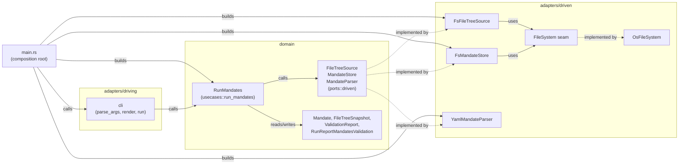

# Mandate parser, validator and run command

This overview gives the big picture of the mandate parser, validator and run
command crate. The documents it links to go deeper into each part.

## Purpose

This Rust crate finds a project's `.mandate` folder and parses every selected
mandate YAML file into a Rust value. It validates each one against the mandate
format and against one shared snapshot of the file tree. Every validation
problem is reported in one pass. A file that fails to parse reports its
first parse error, and the run carries on with the other mandates. The crate
does not read or write `mandate.json` and does not execute a rule. Those are
separate pieces that do not exist yet.

## Architecture at a glance

The crate follows the hexagonal (ports and adapters) pattern. The domain in
the middle owns the interfaces it needs, adapters on the outside implement
them, and nothing inside depends on anything outside. The crate has three
driven ports, three adapters, and one use case in `domain/usecases` that
owns discovery, selection and reporting. Dependencies point inward.
`main.rs`, the composition root, wires concrete adapters into the domain.
The CLI driving adapter calls the use case, and the use case calls the three
driven ports. Nothing in the domain imports an adapter.

Reading the picture from the left, `main.rs` builds the three driven
adapters (`FsFileTreeSource`, `FsMandateStore`, `YamlMandateParser`), hands
them to a new `RunMandates` use case, and calls into the CLI driving
adapter. The CLI adapter is a set of free functions with no state, so
there is nothing to build. It calls the `RunMandates` use case it was
given. `RunMandates` calls the three driven ports (`FileTreeSource`,
`MandateStore`, `MandateParser`) and reads and writes the domain model
types. Exactly one driven adapter implements each port. The two
filesystem-facing adapters, `FsFileTreeSource` and `FsMandateStore`, both go
through the `FileSystem` seam, which `OsFileSystem` implements for real
disk access.

## Where to read next

- [`run-command.md`](run-command.md): how one run flows end to end,
  discovery, selection, per-mandate outcomes, and the rendered report.
- [`ports-and-adapters.md`](ports-and-adapters.md): the file-by-file shape
  of the crate, the three driven ports' signatures, and the file system
  seam.
- [`testing.md`](testing.md): how the test suite is wired, the fixture
  cases, and how to run it.
- [`../reference/mandate-format-checks.md`](../reference/mandate-format-checks.md):
  what parsing rejects and what validation checks, structured for lookup.
