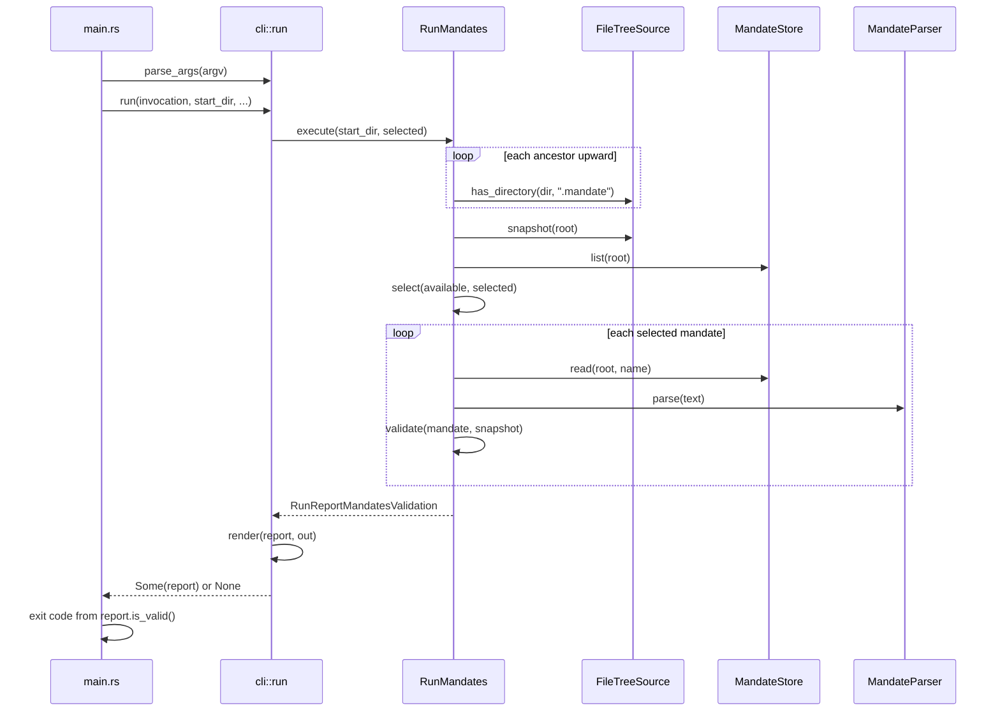

# The run command

This architecture overview follows one flow through the mandate parser
crate, for a reader who wants to know what happens end to end when the
`mandate` command runs. See [`mandate-parser.md`](mandate-parser.md) for
the crate's overall shape.

## How a run flows



One run goes as follows. `main.rs` calls `parse_args` on the CLI adapter
to turn the process arguments into an invocation. It then calls `run` on the
CLI adapter with that invocation and the starting directory, and `run` calls
`execute` on `RunMandates` with the starting directory and the selected
mandate names. `RunMandates` checks each ancestor directory upward with
`FileTreeSource::has_directory` until one holds `.mandate`. It takes one
snapshot of that root with `FileTreeSource::snapshot` and lists the
available mandates with `MandateStore::list`. After choosing which mandates
to run, it reads each one with `MandateStore::read`, parses it with
`MandateParser::parse`, and validates the result against the shared
snapshot. The report goes back to the CLI adapter, which renders it to the
output writer, and then to `main.rs`, which turns it into an exit code.

**Discovery.** With no `--root`, discovery starts at the current directory.
`RunMandates::discover_root` checks each ancestor in turn with
`FileTreeSource::has_directory(dir, ".mandate")`. This is a cheap existence
check that answers `false`, not an error, when a directory cannot be read.
On `false`, discovery moves to the parent and repeats. Reaching the
filesystem root without finding `.mandate` is not an error, because there is
nothing to check yet. The report prints a warning and the run exits 0.
Discovery never looks inside child directories, so a nested project with
its own `.mandate` is ignored. Only the ancestor that holds `.mandate` is
snapshotted. Every ancestor above it gets the existence check and never a
full walk of its tree. Snapshotting every ancestor would walk directories
the current user does not own. A real run hit this and failed with "Access
is denied" on an unrelated system temp folder before it could report that
`.mandate` was missing. The doc comment on `discover_root` records this.

**Snapshot.** `RunMandates` shares the one snapshot of the discovered root
across every mandate in the run, so all mandates see the same view of the
file tree and it cannot change between them. `validate` never takes its own
snapshot. It takes a plain `&FileTreeSnapshot` value, so it has no
dependency on I/O or on the ports.

**Selection.** `MandateStore::list` returns the `.yaml` file names directly
in `.mandate/mandates/`. Selection is by full file name and is
case-sensitive. The `name:` field inside a mandate is descriptive only and
plays no part. With no names given on the command line, every listed
mandate runs. An empty mandates folder gives `RunWarning::NoMandatesFound`,
not an error. A command-line name that matches no file gives
`RunError::UnknownMandate` and stops the run before anything is validated.

**Per-mandate outcome.** Each selected mandate is read, parsed and validated
in turn. A parse failure is recorded in that mandate's slot as
`MandateResult::ParseFailed` and the run continues. Unlike an unknown name,
one invalid mandate does not stop the rest from being reported. A
failure to read a mandate file is a `RunError` and does stop the run.

**Reporting and exit codes.** `RunMandates` fills the report with
everything it finds and never calls `std::process::exit`. The CLI adapter's
`run` function executes the use case, writes the report to the output writer
or the error to the error writer, and returns `Some(report)` or `None`.
`main.rs` wires the adapters, calls `cli::run`, and maps the result to the
exit code. The code is `0` when the report is `Some` and `is_valid()` is
`true`, and `1` otherwise. An argument error or an unreadable current
directory also exits `1`, before the use case runs. Keeping the decision in
`main.rs` lets a planned long-running mode keep running after an invalid
report. An empty mandates folder and a missing `.mandate` folder both exit
`0`, because a warning is not a failure.

## The report

`RunReportMandatesValidation` in `src/domain/model/run_report.rs` is the domain
value the run command produces. Fields: `location` (a `RunLocation` enum
with variants `Found { root, snapshot_entries }` or
`NotFound { searched_from }`), `warnings` (a `Vec<RunWarning>`), and
`mandates` (a `Vec<MandateOutcome>`, one per selected mandate, each pairing
a file name with a `MandateResult` of `ParseFailed(MandateParseError)` or
`Validated(ValidationReport)`). `is_valid()`
is `true` when no outcome is a parse failure and every `ValidationReport` is
valid.

Nothing prints during the run, because `RunMandates` only fills the report.
The report is plain data. The CLI adapter's `render` writes it out once the
run is finished, in the layout below.

Types follow the naming convention `RunReport<Phase>`. A later phase, such
as rule execution, gets its own `RunReport` type and does not grow this one.

Rendered layout when `.mandate` is found:

```
repository: <root>
snapshot: <n> entries

warning: no mandates found in <dir>      (only when it applies)

SOP_Orders.yaml
  error: governed document not found: docs/architecture/order-lifecycle.md
  invalid: 1 errors, 0 warnings

Networking.yaml
  valid: 3 rules, 2 documents, 7 source files

2 mandates checked, 1 invalid
```

When no `.mandate` folder is found from the starting directory upward:

```
warning: no .mandate folder found from <dir> up to the filesystem root

0 mandates checked, 0 invalid
```

Each mandate's block starts with its file name. Next come its
`ValidationReport` lines indented two spaces, or a
`failed to parse: <message>` line for a parse failure. A summary line
follows: `valid: ...` or `invalid: <n> errors, <n> warnings`. The final
line always reports the total mandates checked and how many were invalid.

The message text each finding prints is defined in
[`../reference/mandate-format-checks.md`](../reference/mandate-format-checks.md).
